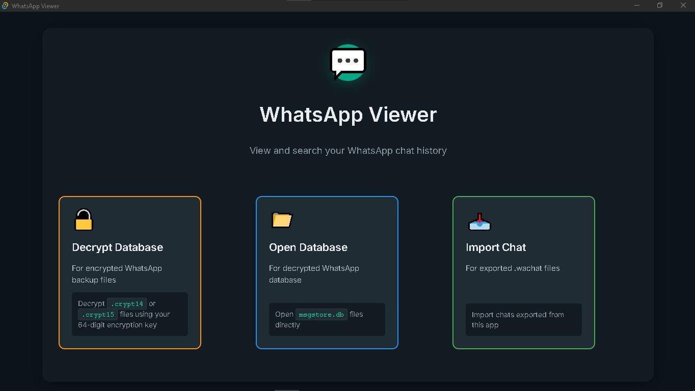
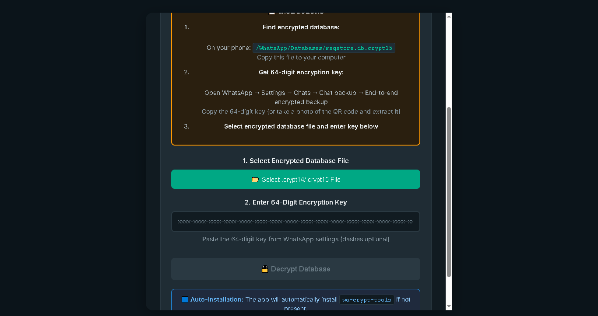
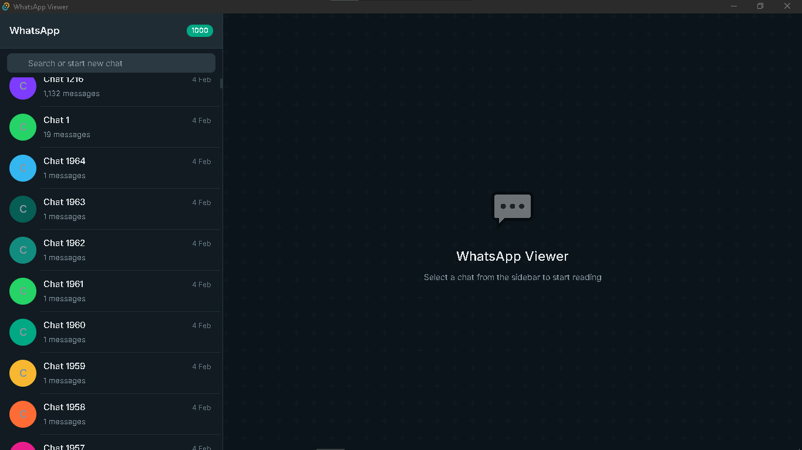
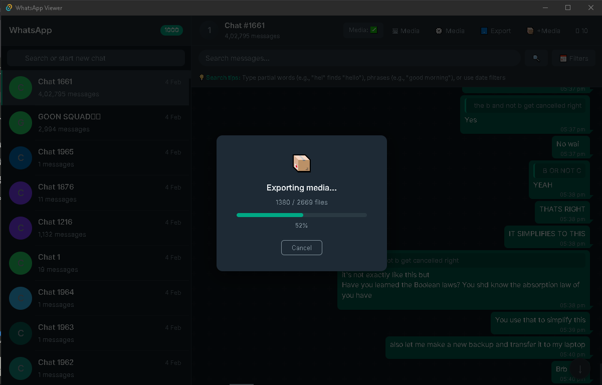
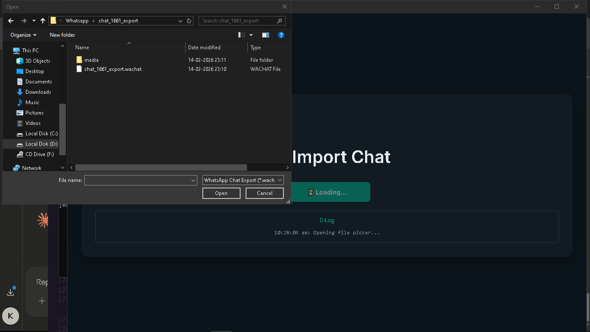
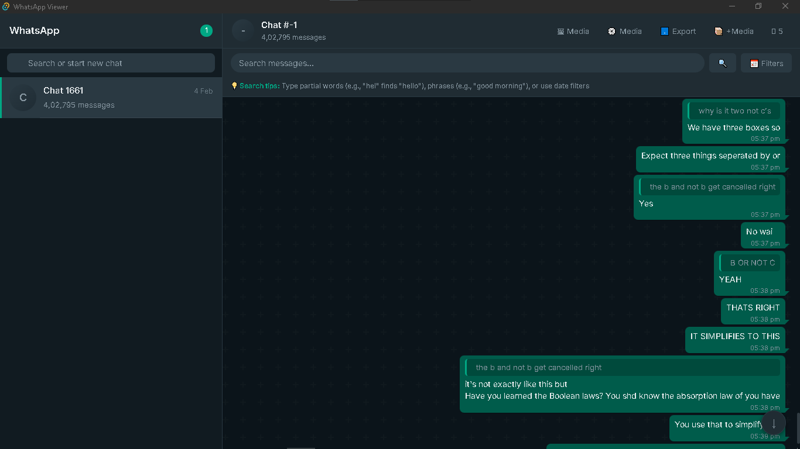

# WhatsApp Viewer

> Browse, search, and archive your WhatsApp chats — fully offline, no phone required.

<!--
  HOW TO ADD SCREENSHOTS:
  1. Create a folder called docs/images/ in this repo
  2. Take screenshots of the app and save them there
  3. The image tags below will automatically show them on GitHub
  Filenames to use are listed in the "How to Add Screenshots" section below.
-->



---

## Why This Exists

WhatsApp has no real way to read your chats on a computer. The official desktop app requires your phone to be nearby and online. Lose your phone, switch platforms, or want to read old messages without WhatsApp open — and you're out of luck.

Worse, people lose years of irreplaceable conversations every time they change phones or switch between Android and iOS. WhatsApp's backup system is locked to their ecosystem and offers no way to simply open and read your own data.

**WhatsApp Viewer** fixes this. It decrypts your backup database locally, lets you browse every chat, photo, and voice message — and lets you export any chat as a portable file to archive or share forever. No phone needed. No WhatsApp account needed.

---

## Features

|     |                                                                        |
| --- | ---------------------------------------------------------------------- |
| 🔓  | Decrypt `.crypt15` / `.crypt14` / `.crypt12` backups with your E2E key |
| 💬  | Browse all chats with message counts and timestamps                    |
| 🖼️  | View images, play videos, and listen to voice messages inline          |
| 🗂️  | Media gallery per chat, grouped by month, filterable by type           |
| 🔍  | Full-text search within any chat, with optional date range filters     |
| ⚡  | Jump directly to any search result in context                          |
| ⬇️  | Export any chat as a portable `.wachat` file                           |
| 📦  | Export chat + media as a `.zip` — only the files used in that chat     |
| 📥  | Import a `.wachat` on any machine — no original database needed        |
| 🖥️  | Windows, macOS, and Linux                                              |

---

## What's new in v2.0.0

- **Gallery ↔ chat navigation** — open any media in the gallery from the chat (🖼 button or the viewer's *View in gallery*), and jump from the gallery back to the message with *Show in chat*.
- **Better media viewer** — full-screen viewer with a toolbar, ‹ › buttons, a position counter and ← / → / Esc keys, in both the gallery and the chat. In the chat it steps through the chat's images and videos; closing it takes you to the message you stopped on.
- **Remembers your media folder** — per database / `.wachat` file, so you don't re-pick it every launch.
- **Click a reply to jump** — clicking a quoted message scrolls to the original, even from search results.
- **System, deleted and sticker messages** — shown properly (group events, "This message was deleted", stickers without a bubble) instead of blank bubbles. `tools/msgtype_diagnostic.py` lists which message types your database uses.
- **Faster search** — an FTS5 (trigram) index, built in the background in the app-data folder (your database is never modified). Results are the same as before; search falls back to the old method if the index isn't ready.

---

## How Decryption Works

WhatsApp stores your Android backup as an encrypted SQLite database at:

```
Android/media/com.whatsapp/WhatsApp/Databases/msgstore.db.crypt15
```

It's encrypted with AES-256-GCM using a key that only you hold — your **End-to-End Encryption key**. WhatsApp Viewer decrypts it locally using that key. Nothing is ever uploaded anywhere.

---

## Step-by-Step: Decrypt Your Backup

### Step 1 — Copy the database from your phone

Connect your Android phone via USB and copy the backup database to your computer:

```
Android/media/com.whatsapp/WhatsApp/Databases/msgstore.db.crypt15
```

Optionally, also copy the media folder if you want to see photos and videos:

```
Android/media/com.whatsapp/WhatsApp/Media/
```

> If you can't see the `Android/media/` path, enable USB file transfer mode (MTP) on your phone, or use ADB:
>
> ```bash
> adb pull "/storage/emulated/0/Android/media/com.whatsapp/WhatsApp/Databases/"
> adb pull "/storage/emulated/0/Android/media/com.whatsapp/WhatsApp/Media/"
> ```

---

### Step 2 — Get your E2E encryption key from WhatsApp

On your phone, open WhatsApp and go to:

**Settings → Chats → Chat Backup → End-to-end Encrypted Backup**

Enable E2E encrypted backup if you haven't already. WhatsApp will display your **64-character encryption key** on screen — screenshot it or write it down somewhere safe.

> The key looks like: `A1B2 C3D4 E5F6 ...` — 64 characters, sometimes shown in groups of 4. Strip the spaces when pasting into the app.

---

### Step 3 — Decrypt in the app

1. Launch **WhatsApp Viewer**
2. Click **🔓 Decrypt**
3. Select your `.crypt15` file
4. Paste your 64-character key into the text box
5. Click **Decrypt**



The database is decrypted in a few seconds — entirely on your machine.

---

### Step 4 — Open your chats

1. Click **📂 Open DB** and select the decrypted `.db` file
2. Optionally click **⚙️ Media** and select your `Media/` folder so photos and videos load
3. All your chats appear in the left sidebar — click any to open it



> **Already have a decrypted database?** Skip Steps 1–3 and go straight to **📂 Open DB**.

---

## Exporting and Sharing Chats

One of the core purposes of this app is letting you **archive and share chats** — something WhatsApp itself makes impossible.

### Export chat only

With a chat open, click **⬇️ Export**. A folder picker opens, and the chat is saved as a `.wachat` file — a self-contained JSON file with every message, timestamp, and sender. Fast and lightweight.

### Export chat with all its media

Click **📦 +Media**. Choose a destination folder, and the app builds a `.zip` containing the chat file _and_ every photo, video, voice message, and document that appears in that specific chat — not your entire media library, just what's in this conversation.

A live progress bar shows files being bundled in real time:



The zip is structured like this:

```
chat_export.zip
├── chat_123_export.wachat        ← all messages as JSON
└── media/
    ├── WhatsApp Images/
    │   └── IMG-20230415-WA0012.jpg
    ├── WhatsApp Video/
    │   └── VID-20230601-WA0003.mp4
    └── WhatsApp Audio/
        └── PTT-20230712-WA0001.opus
```

### Share it — the other person can open it too

Send the `.wachat` file or `.zip` to anyone. On their machine:

1. Install **WhatsApp Viewer**
2. Click **📥 Import** and select the `.wachat` file
3. The full conversation opens immediately — all messages, timestamps, and structure intact
4. To see media: unzip first, then click **⚙️ Media** and point it at the extracted `media/` folder

**They don't need WhatsApp. They don't need your database. They don't need an account.** The exported file is entirely self-contained — everything needed to read the conversation is in the zip.




## Architecture

```
┌─────────────────────────────────────────┐
│           Tauri Shell (Rust)            │
│  • Native file/folder picker dialogs    │
│  • Spawns Python backend as sidecar     │
│  • Force-kills port 8765 on close       │
└────────────────┬────────────────────────┘
                 │ spawns
┌────────────────▼────────────────────────┐
│        Python Backend (FastAPI)         │
│  Binds to 127.0.0.1:8765 only          │
│  • Decryption via wadecrypt CLI         │
│  • SQLite queries (aiosqlite)           │
│  • FTS5 (trigram) search index         │
│  • Media file serving                   │
│  • ZIP export with live SSE progress    │
└────────────────┬────────────────────────┘
                 │ HTTP on localhost
┌────────────────▼────────────────────────┐
│         React Frontend                  │
│  • Virtualised message list (TanStack)  │
│  • Inline audio/video players           │
│  • Media gallery, month-grouped         │
│  • Real-time export progress bar        │
└─────────────────────────────────────────┘
```

---

## Building from Source

### Prerequisites

- [Node.js](https://nodejs.org/) 18+
- [Rust](https://rustup.rs/) stable
- Python 3.10+

```bash
pip install pyinstaller fastapi uvicorn aiosqlite pycryptodome wa-crypt-tools
```

### 1. Build the Python sidecar

**Windows (PowerShell):**

```powershell
cd backend
pyinstaller --onefile --name backend --noconsole `
  --hidden-import uvicorn.logging `
  --hidden-import uvicorn.loops.auto `
  --hidden-import uvicorn.protocols.http.auto `
  --hidden-import uvicorn.lifespan.on `
  --hidden-import aiosqlite `
  --collect-all wa_crypt_tools `
  --hidden-import Crypto `
  main.py

$triple = (rustc -Vv | Select-String "host:").ToString().Split(":")[1].Trim()
New-Item -ItemType Directory -Force -Path "..\src-tauri\binaries"
Copy-Item "dist\backend.exe" "..\src-tauri\binaries\backend-$triple.exe" -Force
```

**macOS / Linux:**

```bash
cd backend
pyinstaller --onefile --name backend \
  --hidden-import uvicorn.logging \
  --hidden-import uvicorn.loops.auto \
  --hidden-import uvicorn.protocols.http.auto \
  --hidden-import uvicorn.lifespan.on \
  --hidden-import aiosqlite \
  --collect-all wa_crypt_tools \
  --hidden-import Crypto \
  main.py

TRIPLE=$(rustc -Vv | grep host | cut -d' ' -f2)
mkdir -p ../src-tauri/binaries
cp dist/backend "../src-tauri/binaries/backend-$TRIPLE"
chmod +x "../src-tauri/binaries/backend-$TRIPLE"
```

### 2. Build the app

```bash
npm install
npm run tauri build
```

Installers land in `src-tauri/target/release/bundle/`.

### Automated builds (GitHub Actions)

Push to `main`, then on GitHub open **Actions → Build & Release → Run workflow** and enter a tag such as `v2.0.0`. GitHub builds for Windows, macOS (Intel and Apple Silicon) and Linux and attaches the installers to the release.

---

## FAQ

**Q: Does this work with iPhone backups?**  
A: Not currently. iOS backups use a different encryption scheme and live in iCloud. This app targets Android `.crypt` databases.

**Q: Is my data sent anywhere?**  
A: No. The backend binds to `127.0.0.1` — your local machine only. Nothing touches the internet.

**Q: The app says "backend failed to start". What do I do?**  
A: The Python sidecar takes 2–4 seconds to boot on first launch. The app retries automatically for 10 seconds. If it keeps failing, port 8765 may already be in use — restart the app.

**Q: Can I view group chats?**  
A: Yes — all chats in the database appear, groups included. Contact names come from whatever WhatsApp stored at backup time.

**Q: Media shows as missing. What's wrong?**  
A: Make sure you're selecting the root `Media/` folder — the one that directly contains `WhatsApp Images/`, `WhatsApp Video/`, etc. — not a subfolder inside it.

**Q: How big are the exports?**  
A: A chat-only `.wachat` export is a few MB even for large chats. A `+Media` zip depends on your content — potentially several GB for media-heavy chats. Images and videos aren't re-compressed (they're already compressed), so zipping is fast.

---

## Privacy

- 100% local — no internet connection required after install
- Backend only binds to loopback (`127.0.0.1`), never your network
- No telemetry, no analytics, no accounts
- Your data never leaves your machine

---
